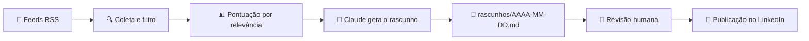

# 🤖 LinkedIn Content Bot

Gerador automático de **rascunhos de posts para LinkedIn** sobre Python e tecnologia. O bot lê blogs de tecnologia via RSS, seleciona as notícias mais relevantes e usa a API do Claude para transformá-las em posts prontos para revisar e publicar.


---

## 📌 Sumário

- [Sobre o projeto](#-sobre-o-projeto)
- [Funcionalidades](#-funcionalidades)
- [Como funciona](#-como-funciona)
- [Tecnologias](#-tecnologias)
- [Instalação](#-instalação)
- [Como usar](#-como-usar)
- [Agendamento diário](#-agendamento-diário)
- [Personalização](#-personalização)
- [Estrutura do projeto](#-estrutura-do-projeto)
- [Boas práticas e segurança](#-boas-práticas-e-segurança)
- [Roadmap](#-roadmap)
- [Contribuindo](#-contribuindo)
- [Licença](#-licença)

---

## 💡 Sobre o projeto

Manter consistência de conteúdo no LinkedIn toma tempo: é preciso acompanhar as novidades, escolher um tema, escrever e revisar. Este projeto automatiza as etapas repetitivas (pesquisa e primeiro rascunho) e **mantém o humano no controle** da parte mais importante: a revisão e a voz pessoal antes de publicar.

> ⚠️ O bot **não publica automaticamente**. Ele gera rascunhos para você revisar, ajustar e postar. Isso mantém a qualidade do conteúdo e respeita os termos de uso do LinkedIn.

## ✨ Funcionalidades

- 📰 **Coleta via RSS** de blogs como Google Developers, TechCrunch, Real Python, Python Insider e Hacker News
- 🎯 **Filtro por relevância**: pontua cada notícia por palavras-chave (o título pesa mais que o resumo)
- 🔁 **Sem repetição**: guarda os links já usados em `usados.json`
- ✍️ **Posts completos**: gancho, explicação, mini exemplo de código Python, pergunta para engajamento, fonte e hashtags
- 📄 **Saída organizada**: um arquivo Markdown por dia em `rascunhos/`
- ⚙️ **Fácil de configurar**: feeds, palavras-chave, quantidade de posts e prompt ficam no topo do script

## 🔄 Como funciona



| Função | O que faz |
|---|---|
| `carregar_usados()` / `salvar_usados()` | Lê e grava os links já utilizados para evitar repetição |
| `pontuar()` | Calcula a nota de relevância de uma notícia |
| `coletar_noticias()` | Lê os feeds, remove notícias já usadas e ordena pela nota |
| `gerar_rascunho()` | Envia a notícia ao Claude e recebe o texto do post |
| `main()` | Orquestra todo o fluxo e salva o arquivo do dia |

## 🛠️ Tecnologias

- [Python 3.9+](https://www.python.org/)
- [feedparser](https://pypi.org/project/feedparser/): leitura de feeds RSS/Atom
- [anthropic](https://pypi.org/project/anthropic/): SDK oficial da API do Claude

## 📦 Instalação

**1. Clone o repositório**

```bash
git clone https://github.com/SEU-USUARIO/linkedin-content-bot.git
cd linkedin-content-bot
```

**2. (Opcional) Crie um ambiente virtual**

```bash
python -m venv venv
source venv/bin/activate      # Linux/Mac
venv\Scripts\activate         # Windows
```

**3. Instale as dependências**

```bash
pip install -r requirements.txt
```

**4. Configure sua chave da API**

Crie uma chave em [console.anthropic.com](https://console.anthropic.com) e defina como variável de ambiente:

```bash
# Linux / Mac
export ANTHROPIC_API_KEY="sua-chave-aqui"

# Windows (PowerShell)
setx ANTHROPIC_API_KEY "sua-chave-aqui"
```

> 🔒 **Nunca** coloque a chave no código nem a envie para o GitHub.

## ▶️ Como usar

```bash
python linkedin_bot.py
```

Saída esperada:

```
Gerando rascunho 1/3: Título da notícia...
Gerando rascunho 2/3: Título da notícia...
Gerando rascunho 3/3: Título da notícia...

Pronto! Rascunhos salvos em: rascunhos/2026-10-16.md
```

Abra o arquivo gerado, escolha a melhor opção, **ajuste com a sua voz** e publique no LinkedIn. ✅

## ⏰ Agendamento diário

**Linux / Mac (cron)**

```bash
crontab -e
```

```
0 8 * * * cd /caminho/do/projeto && python3 linkedin_bot.py
```

**Windows (Agendador de Tarefas)**

1. Criar Tarefa Básica → Diária → 08:00
2. Ação: *Iniciar um programa* → `python`
3. Argumentos: `linkedin_bot.py`
4. Iniciar em: pasta do projeto

## 🎨 Personalização

Todas as configurações ficam no topo do `linkedin_bot.py`:

| Variável | Descrição |
|---|---|
| `FEEDS` | Blogs lidos pelo bot (adicione ou remova à vontade) |
| `PALAVRAS_CHAVE` | Termos que definem o que é relevante |
| `QUANTIDADE_POSTS` | Quantos rascunhos gerar por execução |
| `MODELO` | Modelo do Claude usado na geração |
| `PROMPT` | Instruções de tom, formato e estrutura do post |

💡 **Dica:** refinar o `PROMPT` é a forma mais eficaz de fazer os posts soarem como você.

## 📁 Estrutura do projeto

```
linkedin-content-bot/
├── linkedin_bot.py      # Script principal
├── requirements.txt     # Dependências
├── README.md            # Documentação
├── .gitignore           # Arquivos ignorados pelo Git
├── usados.json          # (gerado) links já utilizados
└── rascunhos/           # (gerado) posts do dia em Markdown
```

## 🔐 Boas práticas e segurança

- Use variáveis de ambiente para a chave da API
- Revise todo conteúdo antes de publicar: IA pode errar ou simplificar demais
- Resuma com suas palavras e **sempre cite a fonte**: não copie artigos
- Evite ferramentas que simulam cliques no LinkedIn; elas violam os termos da plataforma e podem bloquear sua conta
- Alguns feeds podem mudar de URL com o tempo; o bot avisa quando um feed não retorna itens

## 🗺️ Roadmap

- [x] Coleta de feeds RSS
- [x] Pontuação e filtro de relevância
- [x] Geração de rascunhos com IA
- [x] Controle de notícias já usadas
- [ ] Envio dos rascunhos para Telegram ou e-mail
- [ ] Execução na nuvem com GitHub Actions
- [ ] Integração com a API oficial do LinkedIn (publicação após aprovação)
- [ ] Testes automatizados
- [ ] Suporte a múltiplos idiomas e estilos de post

## 🤝 Contribuindo

Contribuições são bem-vindas!

1. Faça um fork do projeto
2. Crie uma branch: `git checkout -b feature/minha-feature`
3. Commit suas mudanças: `git commit -m "feat: minha feature"`
4. Envie a branch: `git push origin feature/minha-feature`
5. Abra um Pull Request

## 📄 Licença

Distribuído sob a licença MIT. Veja o arquivo `LICENSE` para mais detalhes.

## 👤 Autor

**Pedro H Bernardone**
💼 [LinkedIn](https://www.linkedin.com/in/phrodriguesjs)

---

⭐ Se este projeto te ajudou, deixe uma estrela no repositório!
